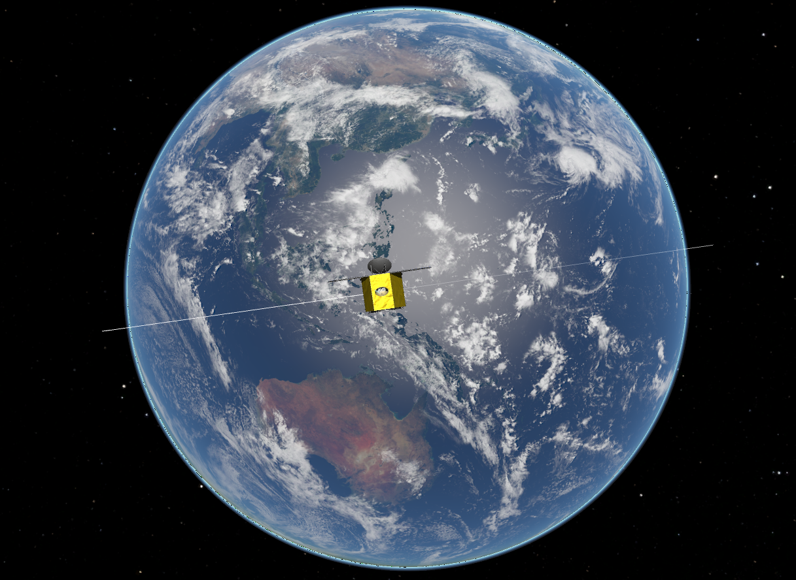

# basilisk-docker

[](https://github.com/theinfinitelabs/basilisk-docker/actions)
[](https://opensource.org/licenses/MIT)
[](https://www.repostatus.org/#active)
[](https://arxiv.org/abs/2605.12443)
[](https://doi.org/10.5281/zenodo.20132421)
[](https://doi.org/10.5281/zenodo.15008785)

Docker-based containerization workflow for the 
[Basilisk](https://hanspeterschaub.info/basilisk) 
astrodynamics simulation framework, encapsulating the complete build environment within a portable Docker container to enable reproducible GN&C simulations across heterogeneous development systems.




## Requirements

- [Docker Desktop](https://www.docker.com/products/docker-desktop)
- [VS Code](https://code.visualstudio.com/) (recommended)

## Quick Start

```bash
git clone https://github.com/theinfinitelabs/basilisk-docker.git
cd basilisk-docker
./build-basilisk.sh
```

Or manually:

```bash
docker compose up -d --build
```

To open a terminal inside the running container:

```bash
docker exec -it basilisk_gnc bash
```

## Notes
- The Dockerfile is located at `docker/Dockerfile`
- Compatible with Ubuntu 22.04 and Python 3.10
- First-time build takes approximately 15-20 minutes
- Subsequent rebuilds use Docker layer caching 
  and are significantly faster
- The `de430.bsp` SPICE ephemeris file is not included 
  due to size; see Section 3 of the companion paper 
  for retrieval instructions
- Running each scenario generates a .bin file in the same
  directory, which can be opened in Vizard for 3D visualization.

## Development History
The Docker configuration in this repository originated from simulation environment work begun in 2021. The workflow was formalized and presented as a workshop at the 46th Rocky Mountain AAS GN&C Conference in February 2024 (Zenodo: 10.5281/zenodo.15008785), and is documented in the companion paper listed above.

## Citation
If you use this software infrastucture or workflow in your research, please cite the appropriate reference:

**Software:**
```bibtex
@software{gupta2026basilisk,
  author       = {Gupta, Anubhav},
  title        = {Basilisk and Docker for Reproducible GN\&C Simulation},
  year         = {2026},
  publisher    = {Zenodo},
  doi          = {10.5281/zenodo.20132421},
  url          = {https://github.com/theinfinitelabs/basilisk-docker}
}
```

**Paper:**
```bibtex
@article{gupta2026basiliskpaper,
  author       = {Gupta, Anubhav},
  title        = {Basilisk and Docker for Reproducible {GN\&C} Simulation: A Workflow Reference},
  journal      = {arXiv preprint},
  year         = {2026},
  eprint       = {2605.12443},
  archivePrefix = {arXiv},
  primaryClass = {eess.SY},
  doi          = {10.48550/arXiv.2605.12443}
}
```

## Acknowledgments

The author thanks Dr. Hanspeter Schaub and the AVS 
Laboratory at the University of Colorado Boulder for 
developing Basilisk.